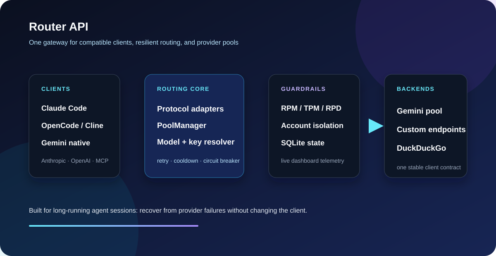

# Router API

<div align="center">

**Anthropic · OpenAI · Gemini → one resilient gateway.**

Key rotation, rate limiting, circuit breaking, custom endpoints, MCP search, and a live dashboard — built for long-running coding-agent sessions.

[](LICENSE)
[](https://www.python.org/downloads/)
[](#client-setup)
[](#dashboard)



[English](README.md) · **[Tiếng Việt](README_VN.md)**

</div>

---

## At a glance

| Capability | What it gives you |
|---|---|
| **Three protocols** | Claude Code, OpenCode, Cline, Gemini clients, and MCP tools behind one base URL |
| **Resilient routing** | Retries, adaptive cooldowns, key rotation, model swapping, and circuit breakers |
| **Account isolation** | Per-account RPM, TPM, RPD, concurrency, and scoped auth tokens |
| **Provider flexibility** | Gemini pools plus OpenAI-compatible custom endpoints as first-class members |
| **Operational visibility** | Live dashboard, request tracing, usage statistics, health probes, and logs |
| **Zero-quota search** | Router-owned DuckDuckGo search without spending Gemini model quota |

> **Best fit:** a local or single-worker gateway for developers who want a coding agent to keep working when a provider key, model, or endpoint temporarily fails.

## Why

Running a coding agent against a single provider key is fragile. You hit 429s mid-task, a key dies and the whole session stalls, and you have no idea which model actually served yesterday's tokens.

Router API sits in front of a **pool of Gemini keys** and a **pool of interchangeable models**, and hides all of it behind three client-compatible protocols:

- **Anthropic Messages API** — Claude Code talks to it unmodified
- **OpenAI Chat Completions** — OpenCode, Cline, anything
- **Gemini native** — pass-through for `generateContent` / `streamGenerateContent`

When a key gets rate limited, the router cools it down and moves on. When a model in the pool starts failing, it swaps members. Your client sees a normal response.

---

## Quick start

```bash
git clone https://github.com/azizu1012/Router-API.git
cd Router-API

python -m venv .venv
source .venv/bin/activate        # Windows PowerShell: .venv\\Scripts\\Activate.ps1

pip install -r requirements.txt
cp .env.example .env             # then fill in GEMINI_API_KEY_1..N
python main.py
```

Dashboard: **http://127.0.0.1:58100/stats**

The API also exposes a built-in reference at **http://127.0.0.1:58100/api/help**.

`main.py` kills any stale process on the port before starting, so re-running is safe.

### Create an account

```bash
python -m src.console.admin_console create coder
python -m src.console.admin_console list --show-keys
```

Accounts are the auth layer in front of the key pool — each gets its own RPM/TPM/RPD budget, so one user cannot exhaust the pool for everyone.

---

## Client setup

### Recommended endpoints

| Client type | Base URL | Credential |
|---|---|---|
| Claude Code / Anthropic | `http://127.0.0.1:58100` | `ANTHROPIC_AUTH_TOKEN` |
| OpenCode / OpenAI-compatible | `http://127.0.0.1:58100/opencode/v1` | `OPENAI_API_KEY` |
| Gemini native | `http://127.0.0.1:58100` | account bearer token |
| MCP clients | `http://127.0.0.1:58100/mcp` | `Authorization: Bearer ...` |

### Claude Code (Anthropic Messages API)

Via `settings.json`:

```json
{
  "env": {
    "ANTHROPIC_BASE_URL": "http://127.0.0.1:58100",
    "ANTHROPIC_AUTH_TOKEN": "sk-<account-key>"
  }
}
```

Or shell:

```bash
export ANTHROPIC_BASE_URL="http://127.0.0.1:58100"
export ANTHROPIC_AUTH_TOKEN="sk-<account-key>"
export ANTHROPIC_MODEL="gemini-flash-35"
claude
```

### OpenCode (OpenAI-compatible)

```bash
export OPENAI_BASE_URL="http://127.0.0.1:58100/opencode/v1"
export OPENAI_API_KEY="sk-<account-key>"
```

Or `opencode.json`:

```json
{
  "provider": {
    "router": {
      "npm": "@ai-sdk/openai-compatible",
      "name": "Router API",
      "options": {
        "baseURL": "http://127.0.0.1:58100/opencode/v1",
        "apiKey": "sk-<account-key>",
        "timeout": 600000,
        "chunkTimeout": 60000
      },
      "models": {
        "gemini-flash": { "name": "Gemini Flash Pool" },
        "gemini-flash-lite": { "name": "Gemini Flash Lite Pool" }
      }
    }
  },
  "model": "router/gemini-flash"
}
```

---

## How routing works

```
Client ──► Proxy layer      format conversion only, no key/pool logic
        ──► PoolManager     retry loop, error classification, member swap
        ──► APIRouter       model + key resolution
        ──► KeyResolver     circuit breaker, adaptive cooldown, Double Random
        ──► GeminiRateLimiter   sliding-window RPM/TPM per key
        ──► GeminiFacade / Custom endpoint
```

Proxies are deliberately dumb: they translate protocols and delegate everything else. All resilience logic lives in `PoolManager`, so a fix there applies to every client protocol at once.

### Virtual model pools

You request `gemini-flash`. Behind it sits an ordered set of interchangeable members:

| Pool | Members | Notes |
|---|---|---|
| `gemini-flash` | `3.8` · `3.7` · `3.6` · `3.5` · `3.0` · `2.5` | 3.7 is capacity-constrained upstream, so its RPM is throttled |
| `gemini-flash-lite` | `3.5-lite` · `3.1` · `2.5` | cheaper tier for sub-agents |

Each member has its own budget. `ModelPool` gives one member one concurrent request at a time, so a slow model cannot starve the others. After `POOL_SWAP_FAILURES` consecutive failures a member is excluded and the router moves to the next.

Aliases follow `gemini-flash-<version>` → `gemini-<version>-flash`. Override any backing model via env (see `.env.example`).

### Resilience

- **Transient vs permanent errors** — `rate_limit` / `unavailable` / `timeout` trigger a short cooldown and a retry; `invalid_key` / `permission_denied` freeze the key for an hour.
- **Double Random** — key choice is randomised over the healthiest 50%, and retry delays carry ±20% jitter. Without both, concurrent requests stampede onto one key and cascade into 429s.
- **Additive sliding window** — RPM/TPM counted in a deque under an `asyncio.Lock`, so the check-and-update is atomic.
- **Extreme mode** — after repeated failures, quotas tighten to 70% and only fully idle keys are used, as a deliberate thermal cutoff.

Custom endpoints (any OpenAI-compatible provider) are first-class pool members via `pool_assignments`, not a side channel.

---

## Web search

Three ways in, all optional:

| Mode | Endpoint | Uses Gemini quota? |
|---|---|---|
| Client-side search | `POST /v1/search` | no |
| Server-side tool loop | `web_search: true` on a completion | no |
| Responses hosted tool | `tools: [{"type": "web_search"}]` on `/v1/responses` | no |

The DuckDuckGo path never touches a Gemini key, so search-heavy agent loops cost nothing against your key budget.

Which engine a search uses follows from the dialect, not from a dashboard toggle:

- All dialects use Router-owned DuckDuckGo search.
- The `search_engine` field remains accepted for wire compatibility, but does not invoke a model-backed search provider.

An app that drives its own loop should prefer `POST /v1/search`: it costs no Gemini
quota and does not spend a second model call re-reading the conversation. The
in-chat tool exists for clients that cannot drive their own loop.

`POST /v1/search` uses `duckduckgo` and returns ranked sources, citations, and
grounded evidence without consuming Gemini model quota.

---


## Endpoints

| Method | Path | Protocol |
|---|---|---|
| `POST` | `/v1/messages`, `/messages` | Anthropic Messages (stream + non-stream) |
| `POST` | `/v1/messages/count_tokens` | Anthropic |
| `POST` | `/v1/chat/completions` | OpenAI |
| `POST` | `/opencode/v1/chat/completions` | OpenAI |
| `POST` | `/v1/responses` | OpenAI Responses — `tools`, `instructions`, `stream` all mapped |
| `POST` | `/v1/models/{id}:generateContent` | Gemini native (pass-through) |
| `GET` | `/v1/models` | OpenAI **and** Anthropic schema superset |
| `POST` | `/v1/search`, `/search` | Router |
| `POST`| `/mcp` | MCP Server — tool `search_web`, Bearer token |
| `GET` | `/dashboard/*` | Dashboard API |
| `WS` | `/dashboard/ws` | Live dashboard stream |
| `GET` | `/health`, `/preflight` | Ops |
| `GET` | `/api/help` | API reference — endpoint + curl thật, cũng là 1 tab trên dashboard |

---

## Dashboard

Open **http://127.0.0.1:58100/stats** after startup to inspect:

- live request activity and model usage;
- key health, cooldowns, transient failures, and pool capacity;
- account budgets, custom endpoints, aliases, and model assignments;
- API examples generated from the routes currently enabled.

The dashboard is optional. The gateway and all client protocols work without opening it.

---

## Configuration

Everything is env-driven; `.env.example` is the reference. The keys that matter most:

| Variable | Default | Purpose |
|---|---|---|
| `GEMINI_API_KEY_1..N` | — | Your key pool. Auto-detected. |
| `ROUTER_API_PORT` | `58100` | Listen port |
| `ROUTER_API_MAX_OUTPUT_TOKENS` | `8192` | Hard output cap |
| `POOL_SWAP_FAILURES` | `5` | Transient errors before a member is swapped |
| `KEY_429_COOLDOWN_SECONDS` | `15` | Cooldown after a rate limit |
| `KEY_INVALID_COOLDOWN_SECONDS` | `3600` | Freeze after an invalid key |
| `*_RPM` / `*_TPM` / `*_RPD` | per model | Per-model budgets |
| `MODEL_CONTEXT_LENGTH` | `185000` | Safe context ceiling reported to clients (Flash/Lite 250k TPM protection) |
| `GEMMA_CONTEXT_LENGTH` | `14000` | Safe context ceiling for Gemma 4 (16k TPM protection) |

> Keys share a project quota in practice — adding more keys to one project does not multiply throughput. The per-model RPM values reflect that.

---

## Custom endpoints

Any OpenAI-compatible provider can join the pool:

```bash
python -m src.console.admin_console endpoint add my-provider https://api.example.com/v1
python -m src.console.admin_console endpoint set-model my-provider my-model
python -m src.console.admin_console endpoint assign my-provider pool gemini-flash:flash
```

The endpoint's model becomes a real pool member with its own slot and concurrency. If the model is not in `MODEL_POOLS`, it falls back to standalone mode (no acquire/release).

---

## MCP Server (Model Context Protocol)

Router API embeds a built-in standard Streamable HTTP **MCP Server** at `/mcp`, allowing AI coding agents (Claude Code, OpenCode, Cursor, Windsurf, Trae, Cline, LibreChat, etc.) to invoke real-time web search natively:

- **Tool:** `search_web(query: string)` — Search the web for current facts, news, documentation, and source citations.
- **100% Free Quota:** Executes in-process via Router's internal DuckDuckGo hybrid search (`execute_hybrid_search`), consuming **zero Gemini API key tokens**.
- **Authentication:** Standard account bearer token (`sk-...`) or master key.
- **`mcp_only` Account Option:** An account can be restricted solely to MCP search, completely blocking chat completion routes.

### Client Integration:

#### 1. Claude Code CLI
```bash
claude mcp add --transport http router-search http://127.0.0.1:58100/mcp \
  --header "Authorization: Bearer <TOKEN>"
```

#### 2. OpenCode (`opencode.json`)
```json
{
  "mcp": {
    "router-search": {
      "type": "remote",
      "url": "http://127.0.0.1:58100/mcp",
      "enabled": true,
      "headers": {
        "Authorization": "Bearer <TOKEN>"
      }
    }
  }
}
```

#### 3. Cursor / Windsurf / Cline / Roo / Trae / LibreChat (`mcp.json`)
```json
{
  "mcpServers": {
    "router-search": {
      "type": "http",
      "url": "http://127.0.0.1:58100/mcp",
      "headers": {
        "Authorization": "Bearer <TOKEN>"
      }
    }
  }
}
```

> **Reverse Proxy / Custom Domain Notice:**  
> The MCP SDK enforces DNS-rebinding protection by default (`421 Misdirected Request`). When serving behind a domain (e.g. `https://my-domain.com/mcp`), configure this in `.env`:
> ```env
> MCP_ALLOWED_HOSTS=my-domain.com,127.0.0.1:*,localhost:*
> ```
> For full troubleshooting and details, see **[docs/mcp_server.md](docs/mcp_server.md)**.

---

## Deploying

See **[DEPLOY_DOMAIN.md](DEPLOY_DOMAIN.md)** for putting this behind a domain with Caddy or Nginx — HTTPS, reverse proxy, systemd unit.

Single-worker only. The SQLite locking is process-local, so multiple Uvicorn workers can hit `database is locked`.

---

## Development

```bash
pytest                                    # full suite
pytest tests/test_anthropic_protocol.py   # protocol conformance
```

CI runs on every push to `main` and every pull request. `ci.yml` runs the full test suite (`pytest -q`) and `scripts/scan_security.py`, and both are blocking — a failing test turns the run red. The [secret scanner](https://github.com/azizu1012/Router-API/actions/workflows/secret_scan.yml) blocks new credentials in the current diff while reporting historical findings without failing. See `docs/ci_workflow.md`.

Further reading in `docs/`:

- **[architecture_overview.md](docs/architecture_overview.md)** — components, data flow, design trade-offs
- **[routing_and_resilience.md](docs/routing_and_resilience.md)** — error taxonomy, Double Random, extreme mode
- **[mcp_server.md](docs/mcp_server.md)** — cấu hình `/mcp` cho Claude Code / OpenCode / Cursor, và lỗi 421
- **[frontend_dashboard.md](docs/frontend_dashboard.md)** — dashboard architecture and state
- **[bug-logs.md](docs/bug-logs.md)** — diagnosed bugs and why they were fixed

---

## Contributing

Issues and PRs welcome. Useful contributions include findings backed by a concrete failure mode, not a generic pattern match.

If you change request parsing or response formatting, add a test. `tests/test_anthropic_protocol.py` and `tests/test_anthropic_integration.py` exist precisely because protocol regressions are silent — the response still parses, it is just wrong.

---

## License

[MIT](LICENSE) © 2026 azizu1012
