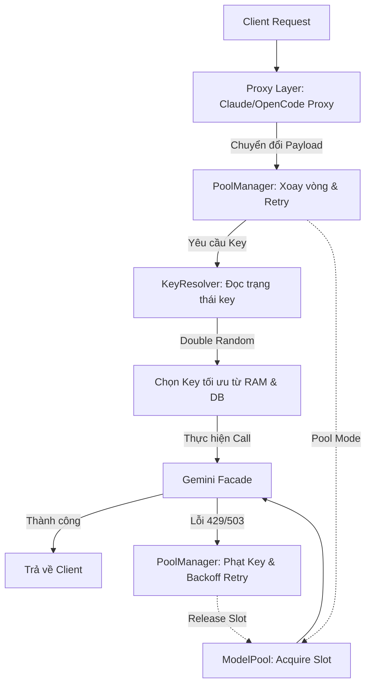

# Kiến Trúc Định Tuyến & Cơ Chế Chống Lỗi (Rate Limit & Resilience Guide)

Tài liệu này giải thích chi tiết các giải pháp kỹ thuật được triển khai trong Router API v2 để đối phó với hiện tượng nghẽn mạng, lỗi Rate Limit (429), lỗi dịch vụ không khả dụng (503), và cơ chế phân phối tải đa luồng có độ tin cậy cao.

---

## 1. Tổng Quan Luồng Request qua Hệ Thống

Khi một Client (như Claude Code hoặc OpenCode) gửi yêu cầu đến Gateway, luồng xử lý đi qua các tầng sau:



1. **Proxy Layer (Tầng chuyển đổi):** [ClaudeProxy](file:///d:/AI_Projects/router_api/src/api/claude_proxy/handler/proxy.py) và [OpenCodeProxy](file:///d:/AI_Projects/router_api/src/api/opencode_proxy/handler/proxy.py) chỉ đóng vai trò chuyển đổi định dạng request/response từ client thành định dạng dùng chung của hệ thống. Tầng này không chứa logic chọn key hay retry.
2. **PoolManager (Tầng điều phối vòng lặp):** [PoolManager](file:///d:/AI_Projects/router_api/src/core/orchestration/pool_manager.py) quản lý vòng lặp xoay vòng (rotation) qua các pool member và thực hiện retry khi gặp lỗi tạm thời. Khi chạy ở pool mode, PoolManager gọi `ModelPool.acquire()` để lấy slot cho mỗi member.
3. **KeyResolver & Router (Tầng quyết định):** [KeyResolver](file:///d:/AI_Projects/router_api/src/core/router/core/key_resolver.py) thực hiện việc tính toán độ ưu tiên (Priority Score), kiểm tra giới hạn RPM/TPM thực tế của từng key, và chọn key.

## 2. Cơ Chế Pool Concurrency (ModelPool)

Để kiểm soát độ đồng thời (concurrency) cho các pool model, hệ thống sử dụng **ModelPool** (`src/core/router/pool.py`) — một Singleton per pool với cơ chế slot-based workers:

- **Mỗi pool member có một `asyncio.Lock` riêng**, đảm bảo tại một thời điểm chỉ một request được xử lý bởi member đó. Điều này ngăn chặn tình trạng quá tải key do nhiều request đồng thời.
- **Custom endpoint là first-class citizen** trong pool: ModelPool ưu tiên chọn custom endpoint members trước Gemini members khi có member rảnh (`acquire`).
- **Model ngoài `MODEL_POOLS` chạy standalone** — không qua `acquire`/`release`, cho phép mỗi key tự quản lý concurrency riêng.
- **`sync_custom_members()`** giải quyết vấn đề cache lạnh: khi custom endpoint được thêm/gán vào pool sau khi ModelPool đã khởi tạo, hàm này cập nhật member list và tạo lock mới mà không cần khởi tạo lại pool.
- **PoolManager** gọi `ModelPool.acquire()` trước khi gửi request và `release()` trong `finally` block, đảm bảo slot luôn được giải phóng.

---


## 3. Cơ Chế Xử Lý Lỗi 429 và 503 (Soft Handling vs Hard Freeze)

Để duy trì hiệu suất cao, hệ thống phân loại lỗi thành hai nhóm chính: **Lỗi tạm thời (Transient Errors)** và **Lỗi vĩnh viễn (Permanent Errors)**.

### Phân Loại Chi Tiết

Hệ thống sử dụng một cách tiếp cận hai tầng để phân loại lỗi: đầu tiên là phân loại lỗi cụ thể của nhà cung cấp (hiện tại là Gemini), sau đó là so khớp dựa trên văn bản cho các lỗi chung.

#### **Tầng 1: Phân loại lỗi Gemini cụ thể (`classify` trong `src/core/providers/gemini/error.py`)**
Đây là tầng phân loại chính xác nhất cho các lỗi cụ thể của Gemini. Nó trích xuất `code` (mã HTTP), `status` (chuỗi trạng thái GRPC/Google Cloud), và `message` từ các ngoại lệ và phân loại theo thứ bậc:

1.  **Mã trạng thái HTTP:** Ưu tiên phân loại dựa trên các mã HTTP (400, 401, 403, 404, 429, 500, 503, 504).
2.  **Chuỗi trạng thái:** Nếu không có mã HTTP rõ ràng, kiểm tra các chuỗi trạng thái như "RESOURCE_EXHAUSTED", "PERMISSION_DENIED", "INVALID_ARGUMENT", "UNAVAILABLE".
3.  **So khớp chuỗi fallback:** Đối với các lỗi ít cấu trúc hơn, sử dụng regex/so khớp từ khóa trong `message`.

#### **Tầng 2: Phân loại lỗi chung (`_classify_error` trong `src/core/orchestration/pool_manager.py`)**
Đây là tầng phân loại thứ hai, hoạt động như một lưới an toàn. Nó gọi `classify(e)` từ tầng 1 trước. Nếu tầng 1 trả về "unknown", nó sẽ tiếp tục thực hiện so khớp dựa trên văn bản với các từ khóa rộng hơn để bắt các lỗi không được phân loại cụ thể bởi tầng Gemini.

**Bảng Ánh Xạ Phân Loại Lỗi:**

| Loại Lỗi (Text/Code Signature) | Lý Do Phân Loại | Mô Tả | Xử Lý |
| :------------------------------ | :-------------- | :---- | :---- |
| Mã HTTP 400, "invalid_argument", "bad_request" | `bad_request` | Yêu cầu không đúng định dạng hoặc tham số không hợp lệ. | Freeze Key + Thử Key Tiếp |
| Mã HTTP 401, "api key invalid", "unauthorized" | `invalid_key` | API Key không hợp lệ hoặc thiếu. | Hard Freeze |
| Mã HTTP 403, "permission denied" | `permission_denied` | Không có quyền truy cập chung. | Hard Freeze |
| Mã HTTP 403, "denied access" | `project_denied` | Không có quyền truy cập vào dự án cụ thể. | Freeze Key + Thử Key Tiếp |
| Mã HTTP 404, "not found" | `unavailable` | Tài nguyên không tìm thấy hoặc model không khả dụng. | Soft Handling |
| Mã HTTP 429, "rate limit", "resource exhausted" | `rate_limit` | Vượt quá giới hạn yêu cầu hoặc token mỗi phút (RPM/TPM). | Soft Handling |
| Mã HTTP 429, "quota exceeded", "daily" | `project_quota_429` | Vượt quá giới hạn yêu cầu mỗi ngày (RPD). | Soft Handling |
| Mã HTTP 500, 503, 504, "unavailable", "overloaded", "timeout" | `unavailable` | Dịch vụ không khả dụng, lỗi máy chủ, hoặc timeout. | Soft Handling |
| "provider search", "web_search", "tool is not allowed" | `search_backend` | Lỗi liên quan đến công cụ tìm kiếm hoặc provider search. | Soft Handling |
| Mọi lỗi khác                    | `unknown`       | Lỗi không xác định. | Soft Handling (mặc định) |

### Sự khác biệt trong cách xử lý:

| Đặc tính | Lỗi Tạm Thời (429, 503, Timeout) | Lỗi Vĩnh Viễn (invalid_key, billing_error) |
| :--- | :--- | :--- |
| **Trạng thái key** | **Soft Handling**: Cooldown cực ngắn (`KEY_429_COOLDOWN_SECONDS` ≈ 8-15 giây). | **Hard Freeze**: Đóng băng dài hạn (`KEY_INVALID_COOLDOWN_SECONDS` = 3600 giây). |
| **Xếp hạng Priority** | Áp dụng hình phạt giảm điểm tạm thời (`apply_error_penalty` trừ điểm score) để tránh chọn lại ngay. | Đóng băng vĩnh viễn trên RAM & DB, không cho phép chọn. |
| **Xử lý Pool** | Không tăng chỉ số lỗi vĩnh viễn của thành viên pool, chỉ tích lũy bộ đếm tạm thời để chuẩn bị swap model qua `model_health` khi vượt quá giới hạn. | Gọi `record_failure` ngay lập tức để giảm `model_health` score và swap sang model thành viên khác hoặc custom endpoint khác. |
| **Độ trễ Retry** | Áp dụng thuật toán **Timing Jitter** rồi thử lại. | Chuyển đổi key hoặc model ngay lập tức. |

---

## 4. Thuật Toán Double Random & Jitter (Tránh Thundering Herd & Key Collision)

Khi hệ thống xử lý đồng thời hàng chục request (high concurrency), nếu tất cả các luồng đều chọn key "tốt nhất" (Greedy Selection) hoặc thử lại cùng một lúc (Synchronized Retry), hệ thống sẽ ngay lập tức kích hoạt lỗi 429 hàng loạt trên key đó (Rate Limit Cascade). 

Để giải quyết triệt để vấn đề này, Router API v2 triển khai thuật toán **Double Random kết hợp Jitter đa tầng** gồm các lớp bảo vệ độc lập:

### Lớp 1: Ngẫu nhiên hóa thời gian chờ (Timing Jitter)
Trong hàm `_retry_delay`, thay vì chờ một khoảng thời gian cố định dạng lũy thừa ($1s, 2s, 4s...$), hệ thống tính toán một độ lệch ngẫu nhiên (Jitter) khoảng $\pm 20\%$ dựa trên khoảng cách cơ sở:

```python
def _retry_delay(attempt: int) -> float:
    if attempt >= getattr(config, "POOL_SWAP_FAILURES", 5) * 2:
        return random.uniform(0.3, 0.7)
    interval = getattr(config, "GEMINI_API_KEY_INTERVAL", 2.5)
    max_cooldown = getattr(config, "KEY_429_COOLDOWN_SECONDS", 15) * 2
    base = min(interval * (2 ** max(0, attempt)), max_cooldown)
    jitter = random.uniform(-base * 0.2, base * 0.2)
    return max(0.5, base + jitter)
```
*Tác dụng:* Phân tán thời điểm gửi lại request của các luồng đang chờ, tránh hiện tượng "Thundering Herd" (nhiều client cùng ùa vào gửi yêu cầu tại cùng một mili-giây).

### Lớp 2: Nhiễu Điểm Ưu Tiên (Priority Score Jitter) & Nhóm Ứng Viên Khỏe
Trong hàm `_select_key_double_random` (`src/core/router/core/key_resolver.py`):
1. **Priority Score Jitter**: Thêm độ lệch ngẫu nhiên $\pm 5\%$ vào điểm Priority của từng key. Điều này ngăn chặn hiện tượng hai key có điểm sát nhau (ví dụ: 100 và 99.9) bị khóa cứng vào một thứ tự cố định ở mọi luồng song song.
2. **Candidate Pool Sizing linh hoạt**: Sắp xếp danh sách key theo thứ tự: ít `active_requests` nhất -> điểm ưu tiên đã có jitter cao nhất -> ít lỗi liên tục nhất.
   - Khi có 1 hoặc 2 key: `pool_size = total_cand` (đảm bảo khi chỉ có 2 key, cả 2 key đều có cơ hội được bốc ngẫu nhiên, khắc phục lỗi `int(2 * 0.5) = 1` từng khiến hệ thống chỉ chọn duy nhất key đầu tiên).
   - Khi có từ 3 key trở lên: lấy nhóm 50% khỏe nhất làm tròn lên `max(2, (total_cand + 1) // 2)`.
3. **Random Selection**: Chọn ngẫu nhiên một key từ nhóm ứng viên này (`random.choice`).

```python
# Sizing nhóm ứng viên khỏe nhất và chọn ngẫu nhiên
total_cand = len(candidates_with_priority)
if total_cand <= 2:
    pool_size = total_cand
else:
    pool_size = max(2, (total_cand + 1) // 2)

chosen_cand = random.choice(candidates_with_priority[:pool_size])
```

### Lớp 3: Độ Trễ Vi Mô Khi Gọi API (Dispatch Micro-Jitter)
Khi có nhiều request đồng thời cùng đổ dồn vào 1 key (`active_requests > 1`) hoặc trong các lần thử lại (`attempt > 0`), hệ thống chèn một độ trễ vi mô từ 5–25ms trước khi phát tín hiệu gọi API ra bên ngoài (`PoolManager._resolve_and_call`). Khoảng trễ cực ngắn này hoàn toàn không làm chậm trải nghiệm của người dùng nhưng đủ để tách rời các xung đột gói tin (packet bursts) ở tầng mạng và gateway nhà cung cấp.

---

## 5. Chế Độ Phòng Chống Nghẽn Tải Cực Cao (Extreme Checking Logic)

Khi một request bị lỗi liên tục và số lần thử lại đạt tới giới hạn nghiêm trọng (`attempt >= 10`), hệ thống sẽ kích hoạt bộ lọc bảo vệ cực đoan (**Extreme Checking**):

1. **Siết chặt hạn ngạch (Throttling down to 70%):** RPM và TPM tối đa cho phép của key bị ép giảm xuống còn 70% công suất thiết kế.
2. **Không chấp nhận chia sẻ tải:** Chỉ những key hoàn toàn rảnh rỗi (`active_requests == 0`) và không trong thời gian cooldown mới được phép sử dụng.
3. **Ưu tiên yêu cầu nhỏ:** Đối với các prompt lớn vượt giới hạn 70% TPM, yêu cầu sẽ bị chặn ngay lập tức nếu key có bất kỳ hoạt động nào trong vòng 60 giây qua, bảo vệ key khỏi bị quá tải hoàn toàn.

Cơ chế này hoạt động như một van an toàn (Safety Valve) giúp hạ nhiệt hệ thống khi đang xảy ra tình trạng bão request 429 trên diện rộng.


---

## 6. Cơ Chế Giới Hạn Tải Trượt (Sliding Window Deque) trong Concurrency

Trong `GeminiRateLimiter` (`src/core/limits/gemini/limiter.py`), các hàng đợi hai đầu (deque) được sử dụng để theo dõi số lượng yêu cầu (RPM) và token (TPM) trong cửa sổ trượt 60 giây. Để đảm bảo an toàn luồng và tính nguyên tử (atomicity) của các thao tác kiểm tra và cập nhật giới hạn, phương thức `acquire_quota` sử dụng một `asyncio.Lock()`.

**Tác dụng:** `asyncio.Lock` bảo vệ toàn bộ khối mã kiểm tra giới hạn (chiều dài deque, tổng token) và cập nhật (thêm yêu cầu/token mới vào deque). Điều này ngăn chặn tình trạng race condition, đảm bảo rằng các thao tác này diễn ra một cách tuần tự và nhất quán, ngay cả khi có nhiều yêu cầu đồng thời trong cùng một tiến trình.

---

## 7. Cơ chế Lan Truyền Lỗi HTTP Chuẩn (Proper HTTP Error Propagation)

### Vấn đề trước refactor:
Trước đó, khi gặp lỗi Rate Limit (429) hoặc Overloaded (503), Claude Proxy luôn bắt ngoại lệ (exception) ở tầng handler bên trong và trả lời client bằng một chuỗi SSE text thông báo lỗi ở mã trạng thái **HTTP 200 OK**:
`⚠️ [Hệ thống quá tải tạm thời / System Overloaded] ⚠️ ...`

Đối với các ứng dụng chat thông thường, điều này giúp hiển thị giao diện thân thiện cho người dùng. Tuy nhiên, đối với **Agent tự trị (như Claude Code)**, đây là một **anti-pattern nghiêm trọng** vì:
- Agent coi thông báo lỗi này là *phản hồi văn bản hợp lệ* từ mô hình và cố gắng "trò chuyện" tiếp, dẫn đến việc nhồi nhét nội dung lỗi vào lịch sử chat (Context Bloat).
- Agent lặp lại yêu cầu liên tục trong một vòng lặp vô hạn (Infinite Loop), khiến dung lượng context tăng vọt nhưng chỉ số token metadata của API response giả lập lại rất nhỏ (làm thanh hiển thị context của người dùng báo sai chỉ số, ví dụ `0.1k/200k`).

### Giải pháp khắc phục:
- **Tách biệt luồng xử lý:** 
  - Với **Main Agent** (luồng chat chính): Loại bỏ try-except giả lập ở Proxy. Khi có lỗi rate limit / timeout, hệ thống sẽ lan truyền (propagate) lỗi lên FastAPI để trả về mã lỗi HTTP thật (`429 Rate Limit` hoặc `503 Overloaded`). Client (Claude Code CLI) khi thấy mã lỗi HTTP này sẽ tự động backoff retry ở tầng client một cách tự nhiên mà không làm bẩn context.
  - Với **Sub-Agent** (luồng chạy lệnh ngầm song song): Tiếp tục giữ cơ chế bắt lỗi và trả về text thông báo mô phỏng mã 200 OK ở hàm `handle_sub_agent_error` để tránh việc CLI của client bị crash đột ngột khi các sub-agent thăm dò tệp bị lỗi tạm thời.

---

## 8. Cơ Chế Tính Điểm Key (Priority Scoring)

Logic tính điểm key ưu tiên nằm trong hàm `get_key_priority` (từ `src/core/limits/gemini/limiter.py`), được sử dụng bởi `KeyResolverMixin` để chọn key hiệu quả nhất.

#### **Các yếu tố được xem xét khi tính điểm:**

*   **`active_requests` (Số yêu cầu đang hoạt động):** Đây là yếu tố quan trọng nhất để cân bằng tải theo thời gian thực. Key có ít yêu cầu đang hoạt động hơn sẽ có ưu tiên cao hơn.
*   **`frozen_until` (Thời gian đóng băng):** Các key đang bị đóng băng (chưa hết thời gian `frozen_until`) sẽ có điểm ưu tiên rất thấp hoặc bị loại bỏ hoàn toàn khỏi danh sách ứng viên.
*   **`consecutive_failures` (Số lỗi liên tiếp):** Key có số lỗi liên tiếp gần đây sẽ bị phạt điểm. Số lỗi càng nhiều, hình phạt càng nặng.
*   **`last_success` (Lần thành công gần nhất):** Key có yêu cầu thành công gần đây hơn sẽ được ưu tiên, phản ánh tính ổn định hiện tại của key.
*   **`_score_penalties` (Hình phạt điểm):** Các hình phạt động được áp dụng cho key vì các lý do lỗi khác nhau (ví dụ: `rate_limit`, `unavailable`) sẽ làm giảm điểm của key đó. Các hình phạt này có thời gian hết hạn và được quản lý trong bộ nhớ và đồng bộ với DB.
*   **`model_priority` (Ưu tiên model):** Một điểm ưu tiên cơ bản có thể cấu hình cho các bí danh model khác nhau (được định nghĩa trong `MODEL_PRIORITY` từ `src/core/config/api_config.py`).
*   **Tier (Hạng của tài khoản):** Hạng của tài khoản người dùng (free, premium, admin) ảnh hưởng đến việc những key nào được xem xét. Key của hạng cao hơn có thể được ưu tiên truy cập vào các pool key chất lượng hơn.

#### **Logic tổng thể:**

Hàm `get_key_priority` kết hợp tất cả các yếu tố này để tạo ra một điểm số số học toàn diện. Điểm số càng cao, key càng được ưu tiên. Điểm này sau đó được sử dụng trong thuật toán `_select_key_double_random` (`src/core/router/core/key_resolver.py`) để sắp xếp và chọn key, đảm bảo rằng các yêu cầu được phân phối một cách hiệu quả và linh hoạt nhất, tối ưu hóa hiệu suất và khả năng chống chịu lỗi của hệ thống.

---

## 9. Effort → Thinking Level và Sự Tôn Trọng Dialect Đích (Cross-Mapping)

Client gõ "suy nghĩ kỹ tới mức nào" bằng bốn cách khác nhau, nhưng tất cả đều có một ý nghĩa. Tầng proxy gộp cả bốn về một `thinking_level` duy nhất cho Gemini, nhưng **truyền nguyên bản** khi đích đến là Custom Endpoint để tôn trọng mô hình của bên thứ ba.

| Client gửi | Nguồn | → Đích: Gemini 3 | → Đích: Gemini 2.5 | → Đích: Custom OpenAI | → Đích: Custom Anthropic |
|---|---|---|---|---|---|
| `output_config.effort` | Anthropic Messages API (Claude Code) | `thinking_level` | `thinking_budget` | KHÔNG GỬI GÌ | KHÔNG GỬI GÌ |
| `thinking.budget_tokens` | Anthropic thinking block | xem bảng ngưỡng | `thinking_budget` | KHÔNG GỬI GÌ | `thinking` block nguyên bản |
| `reasoning_effort` | OpenAI Chat Completions | `thinking_level` | `thinking_budget` | `reasoning_effort` nguyên bản | KHÔNG GỬI GÌ |
| `thinking_level` | field riêng của router | trực tiếp | `thinking_budget` | KHÔNG GỬI GÌ | KHÔNG GỬI GÌ |

### Tôn Trọng Endpoint Đích (Pass-through) và Rủi Ro Cross-Mapping
- **Custom Endpoint như một hộp đen**: Router không thể biết Endpoint đích chạy model gì (gpt-4o không hỗ trợ `reasoning_effort`, Claude 3.5 không hỗ trợ `adaptive`, vLLM có thể từ chối các field lạ). Việc Router tự động dịch chéo (ví dụ dịch từ `reasoning_effort` sang `{"type": "enabled"}`) sẽ ngay lập tức khiến các model này văng lỗi HTTP 400 Bad Request, dẫn tới việc Custom Endpoint bị Circuit Breaker đóng băng 120s ngay từ request đầu tiên ("chưa làm gì đã báo Hệ thống quá tải tạm thời").
- **Nguyên tắc "Chỉ Pass-through"**: 
  - **Đích Anthropic**: Router **bảo toàn nguyên văn** chuỗi JSON `thinking` mà client gửi thay vì tự phán đoán. Nếu Client không gửi `thinking` block, tuyệt đối không tự chế block này. Router tự động xóa `reasoning_effort` (nếu Client là OpenAI) để tránh lỗi 400.
  - **Đích OpenAI**: Router truyền nguyên bản `reasoning_effort`. Tuyệt đối không tự chế `reasoning_effort` nếu Client không yêu cầu. Router tự động xóa `thinking` block (nếu Client là Anthropic) để tránh lỗi 400.

### Gộp Cho Gemini
Gemini 3 nhận enum `minimal/low/medium/high`; Gemini 2.5 chỉ có `thinking_budget` nên level được quy đổi qua `low=1024`, `medium=2048`, `high=4096`.

**Vì sao phải gộp.** `max` không phải từ nào Gemini có, nhưng cả Anthropic lẫn OpenAI đều dùng nó cho đỉnh của thang đo — nên nó hợp nhất về `high`. Một effort bị bỏ qua không phải chuyện vô hại: `low` đến nơi như `high` tốn latency và token ở **mọi** lượt gọi, và người dùng không có cách nào biết vì response vẫn hợp lệ.

Thứ tự ưu tiên khi chuyển đổi cho Gemini: `thinking_level` riêng → `output_config.effort` → `thinking.budget_tokens` → `reasoning_effort`. `thinking: {"type": "disabled"}` là ngoại lệ duy nhất được giữ nguyên — nó tắt thinking thay vì hạ mức.

Ngưỡng `budget_tokens` khi chuyển sang Gemini 3:

| Ngưỡng | Level |
|---|---|
| ≥ 8192 | `high` |
| ≥ 4096 | `medium` |
| < 4096 | `low` |

Test: `tests/test_effort_mapping.py` — pin cả hai chiều, kể cả việc effort cao hơn không bao giờ cho ra thinking ít hơn.

---

## 10. Lịch sử thay đổi

### 2026-07-06 — `bad_request` & `project_denied` không còn là Hard Freeze
- **File:** `src/core/providers/gemini/utils.py` — `handle_error()`
- **Trước:** `bad_request` và `project_denied` raise `RuntimeError` ngay lập tức → FastAPI trả 500, không thử key khác.
- **Sau:** Freeze key 3600s (`KEY_INVALID_COOLDOWN_SECONDS`), apply penalty, `return` → thử key tiếp theo trong pool.
- **Lý do:** Một key invalid/denied không có nghĩa tất cả key đều invalid. Router nên thử key khác trước khi bỏ cuộc.

### 2026-10-06 — `output_config.effort` được map, effort cũ không còn bị đảo ngược
- **File:** `src/api/opencode_proxy/handler/proxy.py` — `_extract_thinking_params()`
- **Trước:** `output_config` không được đọc (mọi effort của Claude Code rơi về `low`); `reasoning_effort: high` → `low`; `reasoning_effort: medium` → `include_thoughts: False` tức **tắt** thinking; `budget_tokens` cao nhất chỉ lên `medium`; `thinking: disabled` bị `return {}` nuốt mất.
- **Sau:** cả bốn nguồn quy về một level; `max` → `high`; `disabled` giữ nguyên.
- **Lý do:** effort là tín hiệu người dùng đưa ra, và map sai nó không tạo lỗi nào để báo — model vẫn trả lời, chỉ là nghĩ sai mức.

### 2026-10-06 — `retry_attempt` luôn bằng 0 trong luồng stream
- **File:** `src/core/orchestration/pool_manager.py` — `call_stream()`
- **Trước:** `pool_try = -1` nằm **trong** vòng `while`, ngay trên `pool_try += 1` → biến thành 0 mỗi vòng. `retry_attempt` truyền vào `_resolve_model()` và `reserve_key()` luôn bằng 0. Trong `call_nonstream()` cùng biến đó nằm **ngoài** vòng lặp nên tăng đúng.
- **Sau:** đặt `pool_try = -1` trước vòng `while`, khớp với `call_nonstream`.
- **Hệ quả:** `retry_attempt` là tham số bật **Extreme Checking** ở attempt ≥ 10 (mục 5). Luồng stream lặp quá 10 lần vẫn không bao giờ bật van an toàn đó, trong đúng lúc tải nặng nhất — trong khi non-stream thì có. Hai nhánh là bản sao của nhau nên lệch nhau là sai.
- **Test:** `tests/test_retry_counter.py` pin bất biến `seen == list(range(len(seen)))` cho cả hai đường. Đưa lại lỗi thì 4 test đỏ.

### 2026-10-07 — Mở rộng Pool 6 Flash & 3 Lite, Dynamic Resolution và Đồng bộ Hai chiều ENV ↔ DB
- **Files:** `src/core/config/api_config.py`, `src/core/limits/account_limiter/capacity.py`, `src/backend/models/config.py`, `src/server/openai_server/routes/app_init.py`
- **Thay đổi:**
  - **Mở rộng Pool:** `gemini-flash` bao gồm 6 model thành viên (`gemini-flash-38`, `37`, `36`, `35`, `30`, `25`); `gemini-flash-lite` gồm 3 model (`gemini-flash-35-lite`, `gemini-flash-lite`, `gemini-flash-25-lite`).
  - **Loại bỏ Hardcode:** `capacity.py` chuyển sang hàm `_resolve_pool_model_ids()` tự động suy luận danh sách backing models từ `MODEL_POOLS` & `AVAILABLE_MODELS`.
  - **Tính toán Pool động:** `api_config.py` tự động tính tổng RPM/TPM/RPD từ các members và tự sinh chuỗi nhãn hiển thị `display` dựa trên thành viên hiện có.
  - **Đồng bộ hai chiều ENV ↔ DB:** File watcher tự động đẩy thay đổi từ `.env` vào SQLite `model_config`, đồng thời Admin UI khi cập nhật DB sẽ tự ghi ngược lại file `.env`.

---

## 11. Các Biến Môi Trường Chính

### Virtual Pools & Backing Model Limits
| Biến Môi Trường | Mặc Định | Mô Tả |
|---|---|---|
| `GEMINI_FLASH_RPM` | `14` | Tổng RPM cho `gemini-flash` pool (tổng từ 6 members: 2+1+2+2+2+5) |
| `GEMINI_FLASH_TPM` | `1500000` | Tổng TPM cho `gemini-flash` pool |
| `GEMINI_FLASH_RPD` | `235` | Tổng RPD cho `gemini-flash` pool (50+15+50+50+50+20) |
| `GEMINI_FLASH_LITE_RPM` | `8` | Tổng RPM cho `gemini-flash-lite` pool (2+3+3) |
| `GEMINI_FLASH_LITE_TPM` | `750000` | Tổng TPM cho `gemini-flash-lite` pool |
| `GEMINI_FLASH_LITE_RPD` | `540` | Tổng RPD cho `gemini-flash-lite` pool (20+500+20) |
| `POOL_SWAP_FAILURES` | `5` | Số lần thất bại liên tiếp trước khi đổi sang pool member tiếp theo |
| `POOL_MAX_ATTEMPTS` | `15` | Số lần thử lại tối đa qua toàn bộ các pool members |
| `POOL_RETRY_SECONDS` | `30` | Ngân sách thời gian retry của một pool request |
| `ROUTER_API_STREAM_OPEN_TIMEOUT_SEC` | `30` | Giới hạn mở stream trước khi xoay member; tách khỏi timeout request tổng |
| `KEY_429_COOLDOWN_SECONDS` | `15` | Thời gian cooldown khi key dính rate limit tạm thời |
| `KEY_INVALID_COOLDOWN_SECONDS` | `3600` | Thời gian đóng băng khi key invalid |
| `MODEL_CONTEXT_LENGTH` | `185000` | Ngữ cảnh an toàn client (Spoofing: bảo vệ hạn mức 250k TPM Google AI Studio) |
| `GEMMA_CONTEXT_LENGTH` | `14000` | Ngữ cảnh an toàn cho Gemma 4 (bảo vệ hạn mức 16k TPM Google AI Studio) |

---

## 12. Safe Context Spoofing, Combo Model Mix & RTK Truncation

### 12.1. Vấn Đề TPM Google AI Studio vs Physical Context Window
Mặc dù các mô hình Gemini Flash có dung lượng Attention Context vật lý là 1,048,576 tokens, Google AI Studio trên Free Tier áp đặt hạn mức thông lượng nghiêm ngặt **250,000 Tokens Per Minute (TPM)** tính theo cửa sổ lăn 60 giây. Nếu một request đơn lẻ (hoặc tổng các request trong 1 phút) vượt quá 250k tokens, Google lập tức trả về mã lỗi `HTTP 429 ResourceExhausted`.

Để giải quyết triệt để vấn đề này mà không cần cắt cụt mù quáng:
1. **Pre-emptive Context Spoofing (185k & 14k):** Gateway báo cho client (Claude Code, OpenCode) thông qua `/v1/models` và Anthropic completion headers rằng context length của Flash/Lite là **185,000 tokens** (và Gemma 4 là **14,000 tokens**). Khi prompt client đạt ~140k–150k, client tự động kích hoạt tính năng compact/summarize tự thân, tạo ra khoảng đệm an toàn 35k–45k tokens bảo vệ tuyệt đối hạn mức 250k TPM.
2. **RTK (Real-Time Kernel) Smart Truncation:** Nâng cấp bộ lọc `rtk.py` xử lý thông minh cả 2 điều kiện:
   - Cắt tỉa theo dòng: các khối dữ liệu $\ge 250$ dòng được giữ lại 50 dòng đầu và 50 dòng cuối.
   - Cắt tỉa theo byte: các khối dữ liệu đơn dòng hoặc ít dòng nhưng kích thước $> 8192$ bytes được giữ lại 4000 ký tự đầu và 2000 ký tự cuối kèm thông báo cắt tỉa.
   - Hỗ trợ đầy đủ `role: "tool"` (OpenAI format) và block `tool_result` (Anthropic format).

### 12.2. Combo Model Mix & Quy Tắc MIN Context
Tính năng Combo Model Mix cho phép người dùng tự mix nhiều System Models và Custom Endpoints thành một Model Alias duy nhất với 2 chiến lược:
- **Waterfall:** Thử lần lượt từng target theo thứ tự cấu hình, tự động chuyển sang target tiếp theo khi target trước gặp lỗi hoặc hết quota.
- **Load Balance:** Phân phối request ngẫu nhiên có trọng số (weighted random) giữa các targets.

**Quy tắc MIN Context Length:**
Khi người dùng kết hợp các model trong Combo (ví dụ Gemini Flash 185k và Custom Endpoint 64k), context length trả về cho client được tự động tính theo công thức:
$$\text{context\_length} = \min_{i}(\text{Target}_i.\text{context\_length})$$
Quy tắc này đảm bảo khi xảy ra fallback từ Target A sang Target B, prompt không bao giờ bị tràn context window của target nhỏ nhất.

### 12.3. Multi-Dialect Stream Keep-Alive Resilience
Để ngăn chặn các client bị ngắt kết nối sau 60 giây im lặng (do model suy nghĩ sâu deep thinking hoặc quá trình xoay key qua nhiều member):
- Nâng `STREAM_STALL_TIMEOUT` từ 60.0s lên **120.0s**.
- Gửi ngay lập tức comment `: keepalive-init\n\n` khi thiết lập kết nối SSE.
- Định kỳ phát comment chuẩn W3C SSE `: keepalive\n\n` mỗi 2.5–3.0s nếu chưa có token mới, duy trì socket TCP luôn ấm mà không làm gãy parser JSON của client.
